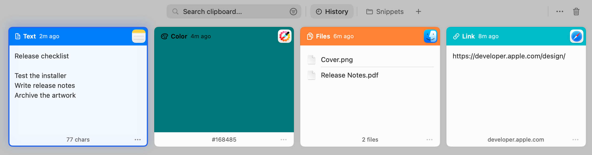
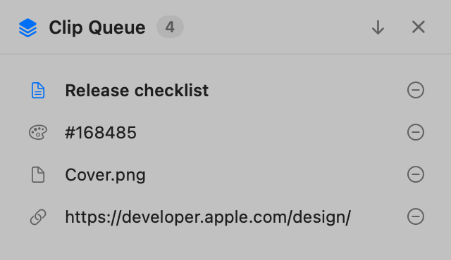

<h1 align="center">
  
</h1>

Find anything you copied on your Mac, and paste items in order with a queue.

  <strong><a href="https://github.com/share-man-man/clidock/releases/latest">Download for macOS</a></strong> · macOS 14+

---

  <strong>English</strong> · <a href="README.zh-CN.md">简体中文</a>

## Clipboard history

Press <kbd>⇧</kbd> <kbd>⌘</kbd> <kbd>V</kbd> to find text, images, links, colors, and files you’ve copied. Keep frequently used clips on a pinboard.

## Clip Queue

Choose **Start Clip Queue** from the menu bar, then copy a few items. In the destination app, press <kbd>⌘</kbd> <kbd>V</kbd> once per item to paste them in order.

## Local & private

- Everything stays on your Mac — no account, no cloud, and no telemetry.
- Exclude specific apps so sensitive copies are never recorded.
- Export and restore your history, pinboards, and exclusions as JSON.

---

Based on [Clipbara](https://github.com/mobrava/Clipbara) · [GPL-3.0-only](LICENSE)
