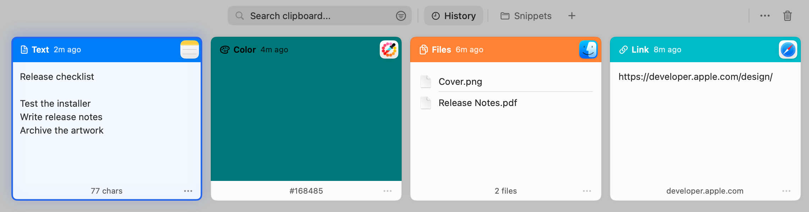
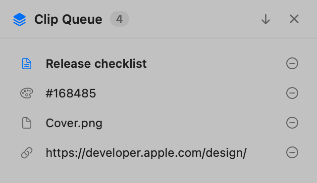

<h1 align="center">
  
</h1>

在 Mac 本地找回复制过的内容，用剪贴队列依次粘贴。

  <strong><a href="https://github.com/share-man-man/popback/releases/latest">下载 macOS 版</a></strong> · macOS 14+

---

  <a href="README.md">English</a> · <strong>简体中文</strong>

## 剪贴板历史

按 <kbd>⇧</kbd> <kbd>⌘</kbd> <kbd>V</kbd> 找回复制过的文字、图片、链接、颜色和文件。常用片段可以收进钉板。

## 剪贴队列

在菜单栏选择「开始剪贴队列」，连续复制几项内容。切回目标应用，每按一次 <kbd>⌘</kbd> <kbd>V</kbd> 就会按顺序粘贴一项。

## 本地与隐私

- 数据全部保存在本机，无账号、无云同步、无遥测。
- 支持按应用排除，敏感内容不会被记录。
- 支持将历史记录、钉板和排除列表导出为 JSON 备份或随时恢复。

---

基于 [Clipbara](https://github.com/mobrava/Clipbara) 开发 · [GPL-3.0-only](LICENSE)
